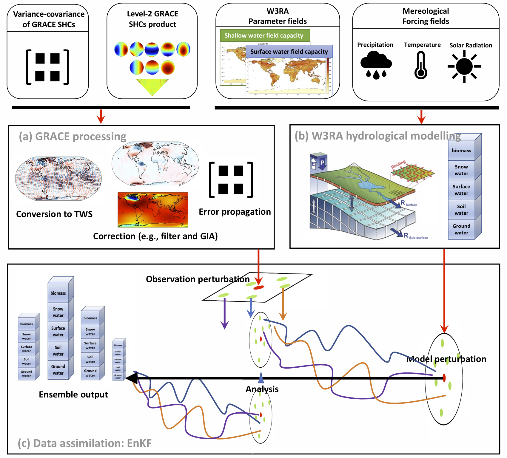

# PyGLDA v1

**PyGLDA** (Python-based Global Land Data Assimilation system) integrates GRACE/GRACE-FO and simulated future-mission
terrestrial water storage (TWS) anomalies into the W3RA hydrological model with an Ensemble Kalman Filter (EnKF),
at up to 0.1° and daily resolution.

## Overview

PyGLDA v1 runs the W3RA model (Python translation, two hydrological response units per cell, ERA5 forcing) as an
ensemble, one MPI rank per member. Observations averaged over basins, sub-basins or regular grid cells update the
model's soil, groundwater, snow, surface water and canopy storages. The increment of each observation window (monthly
or 5-daily) is applied to every day of the window.



### Key features

- One framework for basin-scale and grid-scale DA: any shapefile with a basin and its sub-basins (or grid cells)
  defines the units to be assimilated, from basins to 1°–5° grids
- Observation error covariance between arbitrary units from Monte Carlo samples (SaGEA DDK3), diagonal or full
- Observations of different averaging periods through one interface: monthly GRACE (CSR mascons, SH grids) and
  5-daily ESA-SING future-mission products (GRACE-C, NGGM, MAGIC)
- Filter chosen in the settings (`method.fusion_method`, e.g. the plain stochastic EnKF), inflation as a setting
- Configurable ensemble generation: which forcing variables and model parameters are perturbed, Gaussian or
  triangular, additive or multiplicative, with or without spatial correlation
- Regional and tile-wise global DA; MPI-parallel; shared inputs, spin-ups and open loops reused across cases
- Reproducible runs: every stage works on a recorded copy of its settings, regression tests check bit-identity

## Repository structure

```
py-w3ra/
├── src_GHM/             # W3RA model (Python), configuration, input cropping (Metview)
├── src_DA/              # EnKF variants and filter registry, perturbation, design matrix, basin masks
├── src_OBS/             # GRACE / ESA-SING observation preparation and perturbation
├── src_FlowControl/     # experiment stages (Regional_DA, global_DA, DA_GRACE, OpenLoop), run context and data layout
├── src_postprocessing/  # collection and export of results
├── src_auxiliary/       # tile and shapefile tools, utilities
├── demo/                # drivers, e.g. demo_danube.py; summer-school notebooks
├── settings/            # one folder per case: setting.json, DA_setting.json, pre_process.json, perturbation.json
├── tests/               # regression harness (bit-identity) and reproduction tests
├── doc/                 # installation and configuration guides, settings reference, known issues
└── installation/        # pinned environment, lock file, install and check scripts
```

The repository holds code only. All input data and all results are below one data root (`PYGLDA_V1_DATA`), see
[doc/installation.md](doc/installation.md#6-data) and [doc/configuration.md](doc/configuration.md):

```
<data root>/
├── ERA5/Raw_W3/              # forcing
├── GRACE/                    # mascons, SaGEA DDK3 samples, ESA-SING products
├── basin/shp/                # shapefiles of all unit sets
└── w3ra/
    ├── global/               # global W3RA files (mask, climatology, parameters)
    ├── domains/<domain>/     # cropped input, spin-up, ensembles, open loops (shared by cases)
    ├── units/<unit set>/     # masks, design matrix, prepared observations (shared by cases)
    ├── cases/<case>/         # one DA experiment: settings copy, logs, DA states, results, products
    └── aggregates/<run>/     # global tile-wise products
```

Errors of all runs are collected in the repository's `log/` folder (`log/errors.log`, one detail file per error in
`log/errors/`); each case keeps its full logs in `cases/<case>/log/`.

## Installation

### 1. Clone this repository

```bash
git clone https://github.com/AAUGeodesyGroup/PyGLDA.git
cd PyGLDA
```

### 2. Install the environment

```bash
# pinned conda-forge environment from the lock file, MPI (MPICH), Metview; runs the checks at the end
bash installation/install.sh                          # desktop: conda env 'pyglda_v1'
bash installation/install.sh --prefix /work/<data>/envs   # HPC / UCloud: env under a persistent folder
```

A plain `pip install` does not give a working environment (Metview, GDAL/PROJ and one HDF5 for h5py and netCDF4).
See [doc/installation.md](doc/installation.md) for the HPC set-up, job sizes and troubleshooting, and
`bash installation/check_install.sh` to re-check an environment.

### 3. Get the data

Input data are not part of the repository. A sample for the summer school (one year, small basins) is available at
https://drive.google.com/drive/folders/1ZDU9oUnpUaTC9H9Bv4spZa8-_z9d-9Ib; the layout of a full data root is given in
[doc/installation.md](doc/installation.md#6-data).

## Usage

Experiments are run stage by stage by a driver in `demo/`; the settings are in `settings/<case>/`
(see [doc/configuration.md](doc/configuration.md) and the one-page [doc/settings_reference.md](doc/settings_reference.md)).

```bash
export PYGLDA_V1_DATA=/path/to/data_root
cd demo
python demo_danube.py --basin DRB --stages forcing,grace,spinup      # crop forcing, prepare GRACE, spin-up
mpiexec -n 31 python demo_danube.py --basin DRB --stages ol,da        # open loop and DA (30 members + control)
```

Known limitations and their status are listed in [doc/known_issues.md](doc/known_issues.md).

## Discussion

Questions, suggestions and comments are welcome in the discussion forum: https://github.com/orgs/NCSGgroup/discussions

## Acknowledgements

PyGLDA uses a Python translation of the **W3RA** model (World-Wide Water Resources Assessment, van Dijk et al.); W3RA
data: https://www.dropbox.com/scl/fo/b0hneugr9vao0rqm4oh86/AEPPU-QG6kgh9wTlIBgiwMQ?rlkey=q7ux08mitdghnoac3e4spwaev&e=1&dl=0

This work is supported by the Danmarks Frie Forskningsfond [10.46540/2035-00247B] through the DANSk-LSM project, and
by the National Natural Science Foundation of China (Grant No. 42274112 and No. 41804016).

## Citation

If you use PyGLDA in your research, please cite:

> Yang, F., Schumacher, M., Retegui-Schiettekatte, L., van Dijk, A. I. J. M., and Forootan, E.: PyGLDA: a fine-scale
> python-based global land data assimilation system for integrating satellite gravity data into hydrological models,
> *Geoscientific Model Development*, 18, 6195–6217, https://doi.org/10.5194/gmd-18-6195-2025, 2025.

## License

PyGLDA v1 is licensed under the **MIT License**. See [LICENSE.txt](LICENSE.txt).

## Contact

Fan Yang — [fany@plan.aau.dk](mailto:fany@plan.aau.dk)
Geodesy Group, Department of Sustainability and Planning, Aalborg University (https://aaugeodesy.com/)

Developers: Fan Yang, Ehsan Forootan (efo@plan.aau.dk), Leire Retegui-Schiettekatte (leirears@plan.aau.dk),
Maike Schumacher (maikes@plan.aau.dk)
